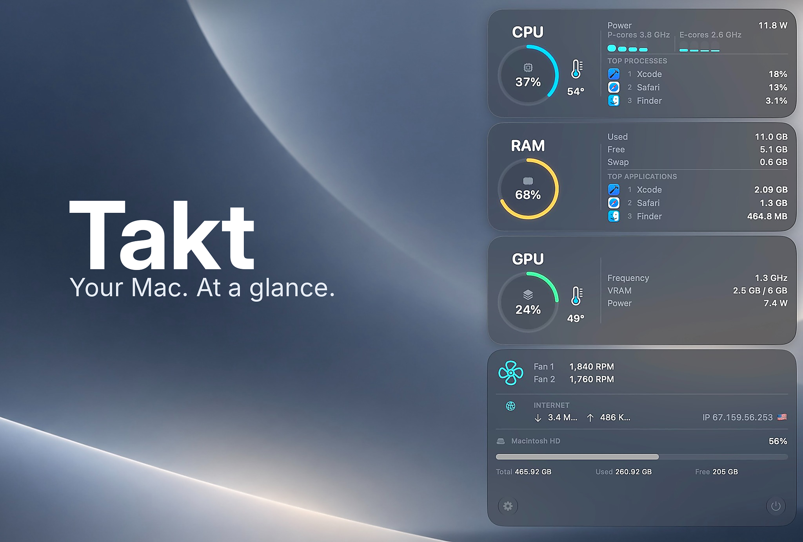

# Takt

Takt is a lightweight open-source system monitor for the macOS menu bar.
It displays CPU, GPU, memory, temperatures, fans, network activity, storage,
and the processes using the most resources in a compact Liquid Glass panel.

## Requirements

- macOS 26 or newer
- Apple silicon Mac is recommended for complete hardware telemetry

Some low-level readings depend on undocumented AppleSMC and IOReport interfaces.
They may be unavailable on particular hardware or change in future macOS releases.

## Installation

1. Download the latest `Takt.zip` from [Releases](../../releases/latest).
2. Unzip it and move `Takt.app` to `/Applications`.
3. Because public builds are not signed with an Apple Developer certificate,
   control-click `Takt.app`, choose **Open**, then confirm **Open** on first launch.

Takt can subsequently be enabled under **Open at login** in its settings.

## Build from source

1. Clone this repository.
2. Open `Monit.xcodeproj` in Xcode 27 or newer.
3. Select the `Monit` scheme and run the project.

The application product and bundle are named `Takt`; the original internal
Xcode target name remains `Monit`.

## Privacy

Takt processes system metrics locally. To show the public IP address and country,
it makes requests to `api.ipify.org` and `api.country.is`. No analytics or
tracking SDKs are included.

## License

Takt is available under the [MIT License](LICENSE). Third-party acknowledgements
are listed in [THIRD-PARTY-NOTICES.md](THIRD-PARTY-NOTICES.md).
